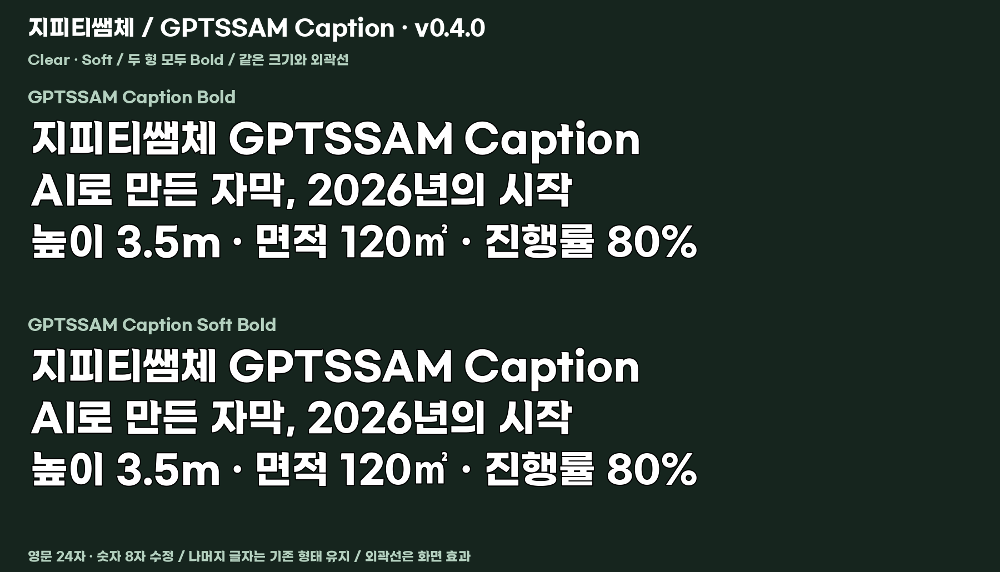

[English](README.en.md) · [简体中文](README.zh-CN.md) · [日本語](README.ja.md) · [한국어](README.ko.md)

# GPTSSAM Caption · v0.4.0

Korean caption fonts with curved terminals, derived from **Gmarket Sans Bold**. **GPTSSAM Caption** is the primary design with more distinct curves; **GPTSSAM Caption Soft** uses gentler curves. Both are **Bold**; Soft is not a lighter weight.

## Download and try

| File | Variant | Style |
|---|---|---|
| [GPTSSAMCaption-Bold.ttf](GPTSSAMCaption-Bold.ttf) | Clear · primary | Bold |
| [GPTSSAMCaptionSoft-Bold.ttf](GPTSSAMCaptionSoft-Bold.ttf) | Soft · alternative | Bold |

Open a TTF file, then select **Raw / Download raw file** on GitHub. To get the whole package, choose **Code → Download ZIP**. Extract the ZIP before installing a font. On macOS, open the TTF in Font Book and install it; on Windows, right-click the TTF and select Install. Restart your editor if the font list has not refreshed. Replace an older installation of the same family rather than keeping duplicate versions.

For an installation-free comparison, download the repository and open [font-test.html](font-test.html) locally. It embeds both fonts and works offline. Change the sentence, size, outline, spacing and background. The outline is a preview/editor effect, not part of the TTF.

## Design and character coverage

- 11,172 precomposed Hangul syllables, ASCII Latin letters, digits and punctuation are supported. Hangul designs, character mapping and widths are unchanged from v0.3.1.
- v0.4.0 modifies the terminals of 24 Latin letters and eight digits: `ACEFGHILMPSTaefhilmnprst` / `12345679`.
- Other glyphs retain their previous shapes. Closed forms `O`, `o`, `0`, `8` are retained; lowercase `l` has a short right tail in both variants.
- Four-language documentation does not imply full Chinese or Japanese glyph coverage. Check your own text for unsupported characters.
- [Full Latin/digit proof](glyph-proof.png) · [Exact release scope and font hashes](manifest.json).

## License

Personal and commercial use, modification and redistribution are allowed under the included [LICENSE.txt](LICENSE.txt). No separate advance permission is required when its conditions are met. Videos, ads, paid courses and printed works made with the font do not have to be released for free.

Keep the original copyright notice and complete license when redistributing the font; modified fonts remain under the same license and must follow the naming requirements. Do not sell the font by itself or imply Gmarket endorsement. Original Gmarket Sans copyright: **eBay Korea Co., Ltd.** This is an independent derivative, not an official Gmarket collaboration.

The bundled original text, including Gmarket's additional clause 6 about promotional use of images of works and the ability to express refusal, is preserved unchanged. That clause is not a requirement to obtain permission before modification or redistribution. This README is an explanatory summary; the complete terms are in LICENSE.txt.

## Release

Approved on 2026-10-26. The final files preserve the approved Clear/Soft preview outlines; final family names and version metadata replace the preview names. [Change log](CHANGELOG.md). No claim is made that every glyph was manually reviewed or that installation was tested in every editor.
