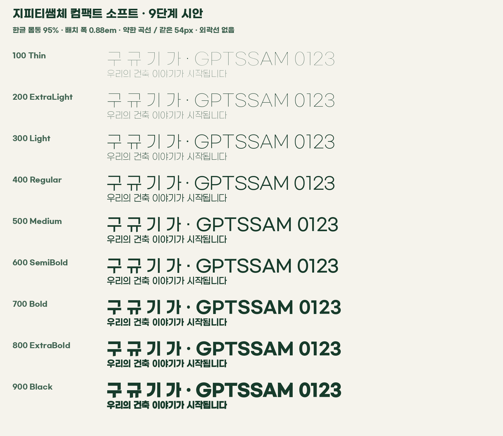

[English](README.en.md) · [한국어](README.ko.md) · [日本語](README.ja.md) · [简体中文](README.zh-CN.md)

# GPTSSAM Compact Soft · v0.5.0-preview.1

**Nine-weight design preview. The existing v0.4.0 release remains available.**

A Gmarket Sans-derived Korean caption family with narrower Hangul, tighter advances and gently curved terminals. Nine static TTF weights, Thin–Black, each contain 11,172 precomposed Hangul syllables.

## Download and try

| Weight | TTF |
|---|---|
| 100 Thin | [Thin](GPTSSAMCompactSoftPreview-Thin.ttf) |
| 200 ExtraLight | [ExtraLight](GPTSSAMCompactSoftPreview-ExtraLight.ttf) |
| 300 Light | [Light](GPTSSAMCompactSoftPreview-Light.ttf) |
| 400 Regular | [Regular](GPTSSAMCompactSoftPreview-Regular.ttf) |
| 500 Medium | [Medium](GPTSSAMCompactSoftPreview-Medium.ttf) |
| 600 SemiBold | [SemiBold](GPTSSAMCompactSoftPreview-SemiBold.ttf) |
| 700 Bold | [Bold](GPTSSAMCompactSoftPreview-Bold.ttf) |
| 800 ExtraBold | [ExtraBold](GPTSSAMCompactSoftPreview-ExtraBold.ttf) |
| 900 Black | [Black](GPTSSAMCompactSoftPreview-Black.ttf) |

The installed family name is **GPTSSAM Compact Soft Preview**. These are nine static fonts, not a variable font. Open the TTF in macOS Font Book or right-click to install on Windows; restart your editor if needed. This family can coexist with GPTSSAM Caption and Caption Soft.

Extract the release ZIP and open [font-test.html](font-test.html) for an offline tester with all nine fonts embedded. Change text, size, outline, spacing and background. Outlines are display effects, not baked into the font. [Caption proof](caption-proof.png) · [Latin/digit proof](latin-proof.png).

## Design and coverage

- Hangul bodies are 95% of their Gmarket source width; Hangul advances are 0.88em. Vertical placement/metrics are also adjusted.
- Gentle curves on exposed initial-consonant and vowel terminals; reduced decoration in tight spaces.
- Each weight includes 11,172 Hangul syllables and ASCII Latin letters, digits and punctuation. Translated documentation does not imply full Chinese/Japanese glyph support.
- Latin/digits remain Gmarket-based and do not receive the Hangul width/advance treatment.
- Paperlogy's Hangul proportions informed this study. New font outlines are derived from Gmarket, not Paperlogy or Montserrat.
- **ExtraBold (800)** uses the source weight closest to the previous v0.4.0 Bold. Weight names across these families are not direct equivalents.

## Preview limitations

Built from Gmarket Light/Medium/Bold using topology-guarded outline expansion/erosion for intermediate and extreme weights, not compatible-master interpolation. Some glyphs receive reduced changes to retain connections and counters, so optical weight consistency still needs review.

Complex Black finals, inter-weight balance and I/l/1 distinction need refinement. The v0.4.0 lowercase-l foot has not been ported. Incompatible original hinting was removed; small-size Windows rendering and editor installation need separate review.

Automated coverage, advances and topology checks passed; this is not an assertion of manual review of every glyph or compatibility with every editor. [Verification](verification.json) · [Manifest](manifest.json).

## License and history

Original eBay Korea Co., Ltd. copyright and complete [LICENSE.txt](LICENSE.txt) are preserved. Follow its terms for use, modification and redistribution. This is not an official Gmarket collaboration or endorsement.

[Change log](CHANGELOG.md) · [Original v0.4.0 files and documentation](https://github.com/gptssam/gptssam-caption/tree/v0.4.0) · [All releases](https://github.com/gptssam/gptssam-caption/releases).
